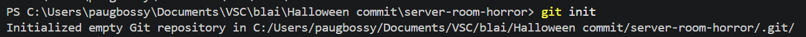
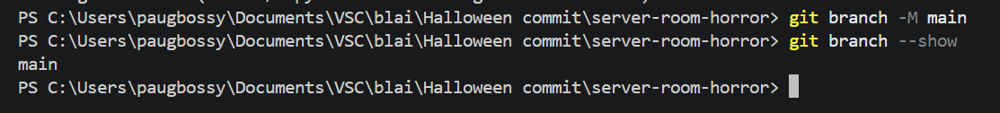
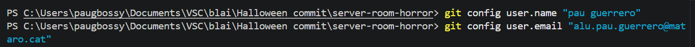
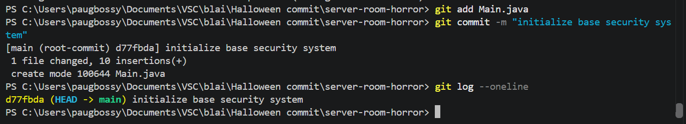
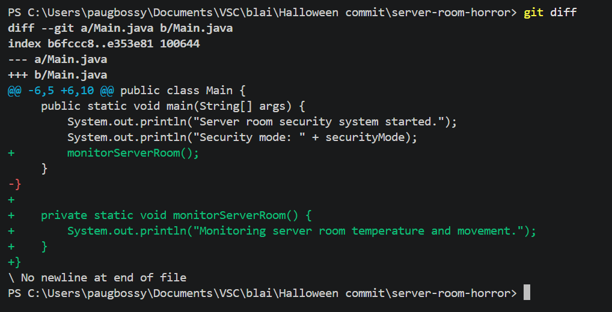
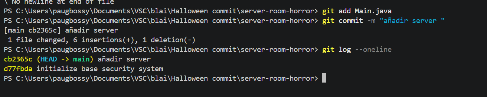
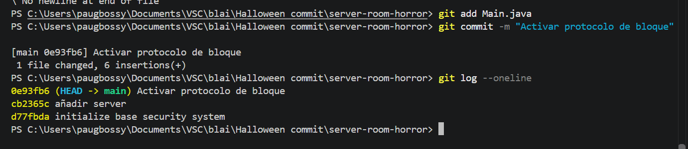
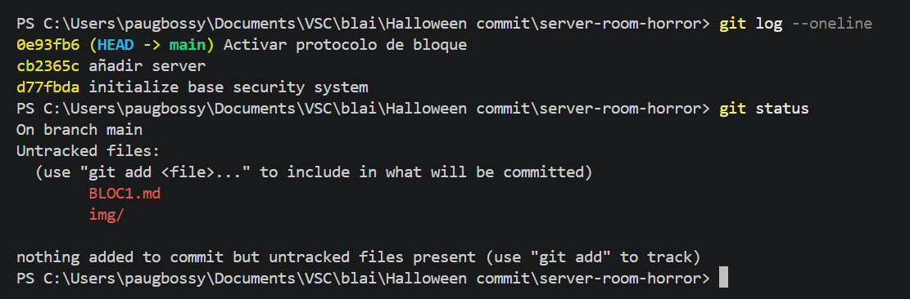

# Bloc 1

## Acció 3.1

S'ha creat i inicialitzat el repositori amb la branca principal `main`.

```bash
mkdir server-room-horror
cd server-room-horror
git init
git branch -M main
```




## Acció 3.2

S'ha configurat el nom i el correu de l'autor.

```bash
git config user.name "Pau Guerrero"
git config user.email "alu.pau.guerrero@mataro.epiaedu.cat"
```



## Acció 3.3

S'ha creat `Main.java` i s'ha guardat el primer commit.

```bash
git add Main.java
git commit -m "chore: initialize base security system"
```



## Acció 3.4: Primera modificació

S'ha afegit la monitorització de la sala de servidors i s'ha creat el segon commit.

```bash
git diff
git add Main.java
git commit -m "feat: add server room monitoring"
git log --oneline
```




### Segona modificació

S'ha afegit el protocol de bloqueig de l'edifici i s'ha creat el tercer commit.

```bash
git diff
git add Main.java
git commit -m "feat: activar protocolo de bloqueo del edificio"
git log --oneline
```



## Acció 3.5: Comprovació de l'historial

S'ha comprovat que els tres commits apareixen correctament i que no queden canvis pendents.

```bash
git log --oneline
git status
```

