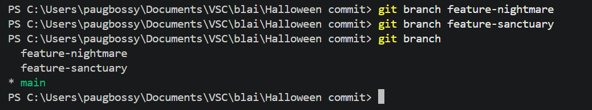
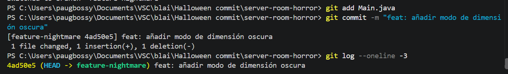
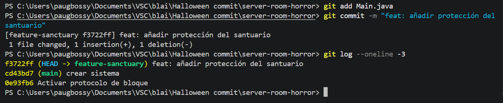
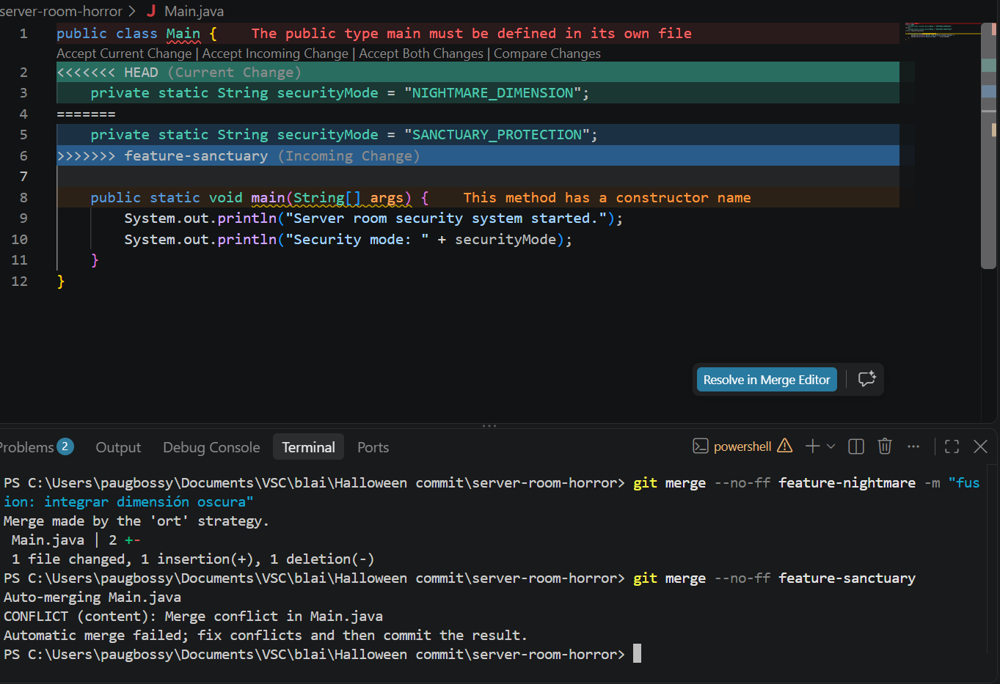
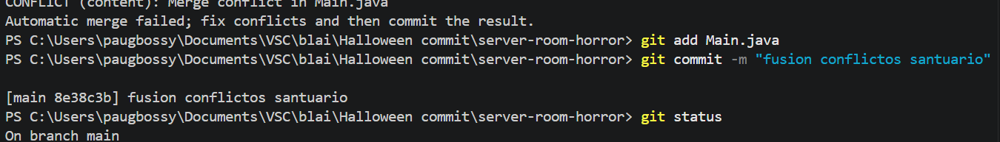

# Bloc 2

## Acció 3.6: Creació de les branques

S'han creat dues branques des del mateix punt de `main` per treballar amb dues versions separades del codi.

```bash
git branch feature-nightmare
git branch feature-sanctuary
git branch
```



## Acció 3.7: Branca feature-nightmare

S'ha modificat el mode de seguretat a la branca `feature-nightmare` i s'ha registrat el canvi.

```bash
git switch feature-nightmare
git diff
git add Main.java
git commit -m "feat: añadir modo de dimensión oscura"
git log --oneline -4
```



## Acció 3.8: Branca feature-sanctuary

S'ha modificat la mateixa línia a `feature-sanctuary` amb un mode de protecció diferent.

```bash
git switch feature-sanctuary
git diff
git add Main.java
git commit -m "feat: añadir modo de protección del santuario"
git log --oneline -4
```



## Acció 3.9

S'ha integrat `feature-nightmare` a `main`. En integrar `feature-sanctuary`, Git ha detectat un conflicte perquè les dues branques modificaven la mateixa línia.

```bash
git switch main
git merge --no-ff feature-nightmare -m "fusion: integrar dimensión oscura"
git merge --no-ff feature-sanctuary
```



## Acció 3.10

S'han eliminat manualment les marques del conflicte i s'ha establert el mode definitiu `SANCTUARY_CONTAINMENT`.

```bash
git add Main.java
git commit -m "fusion: resolver conflicto con contención del santuario"
git status
```



