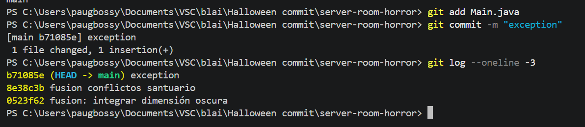
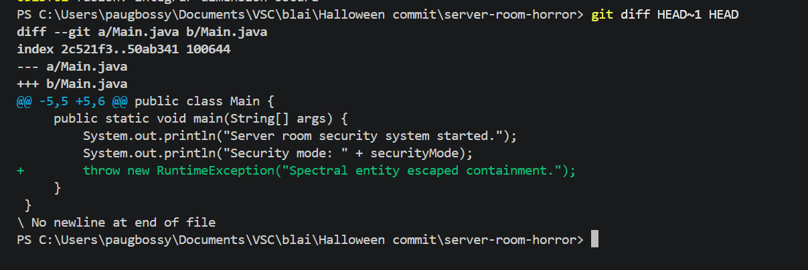
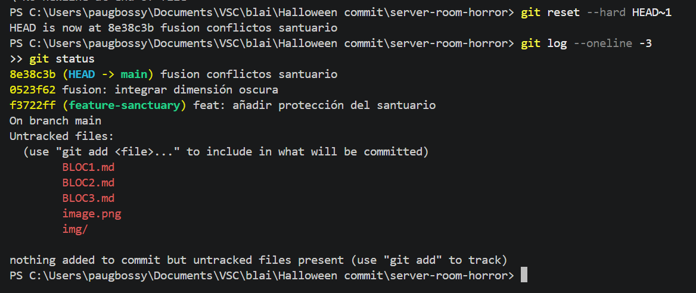
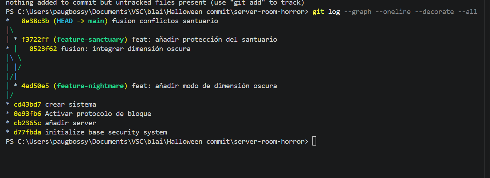

# Bloc 3

## Acció 3.11

S'ha introduït una excepció maliciosa i s'ha registrat el commit infectat.

```bash
git add Main.java
git commit -m "feat: unhandled spectral exception"
git log --oneline -3
```



## Acció 3.12

S'ha comparat el commit infectat actual amb l'últim punt segur per identificar la línia maliciosa.

```bash
git diff HEAD~1 HEAD
```



## Acció 3.13

S'ha eliminat el commit infectat i s'ha restaurat l'últim estat segur del projecte.

```bash
git reset --hard HEAD~1
git log --oneline -3
git status
```



## Acció 3.14

S'ha visualitzat la topologia final del repositori amb les branques, els commits i les fusions realitzades.

```bash
git log --graph --oneline --decorate --all
```



## Acció 3.15

S'ha vinculat el repositori local amb GitHub i s'han publicat la branca principal i les branques de treball.

```bash
git remote add origin URL_DEL_REPOSITORI
git push -u origin main
git push --all origin
git remote -v
git branch -av
```

